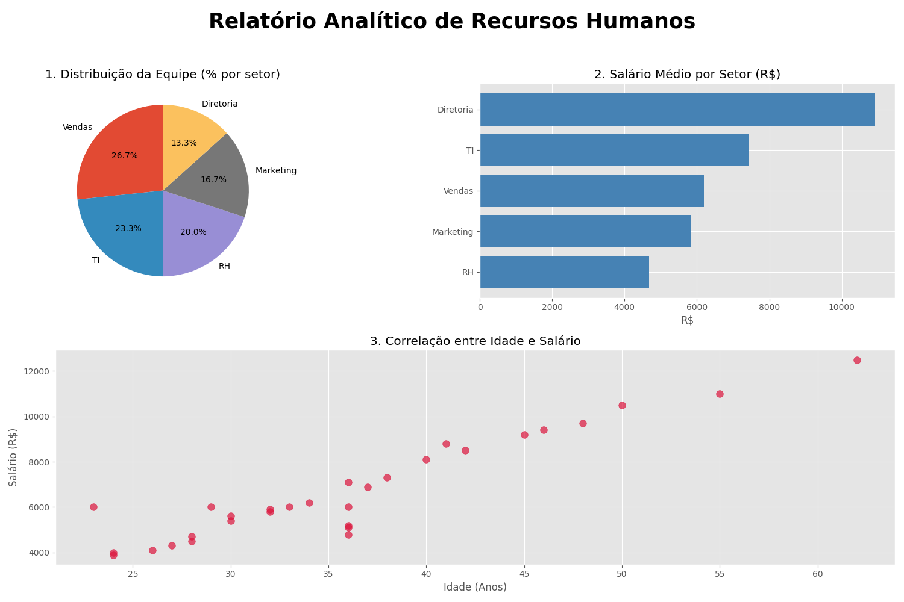
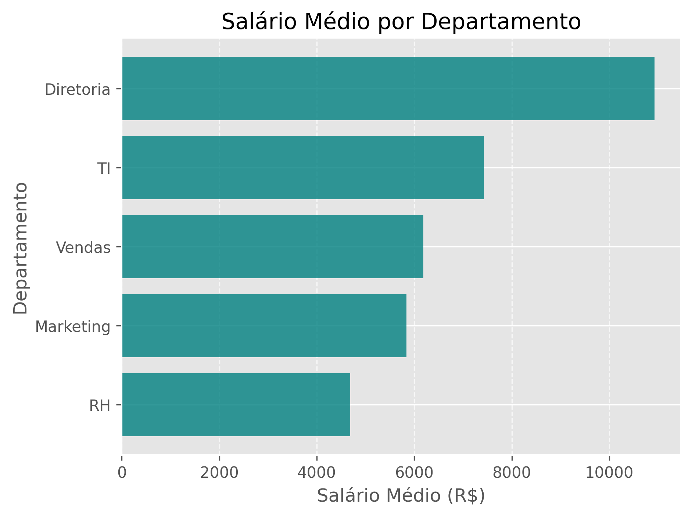
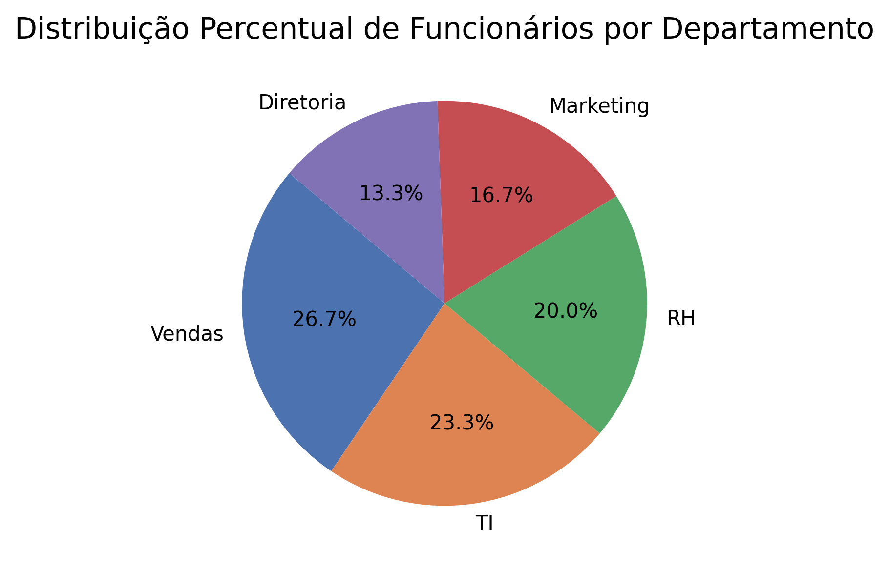
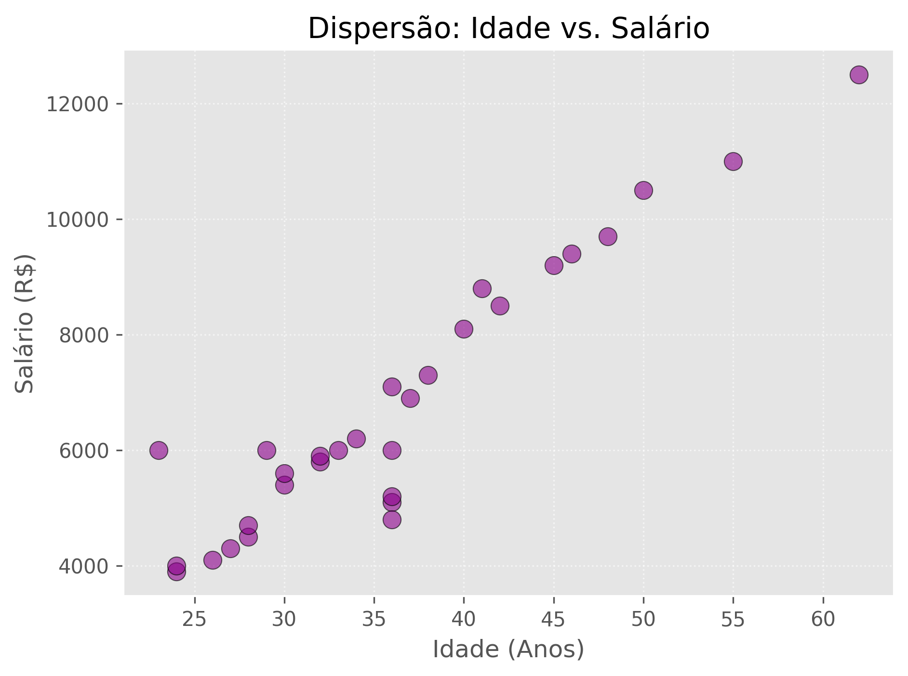
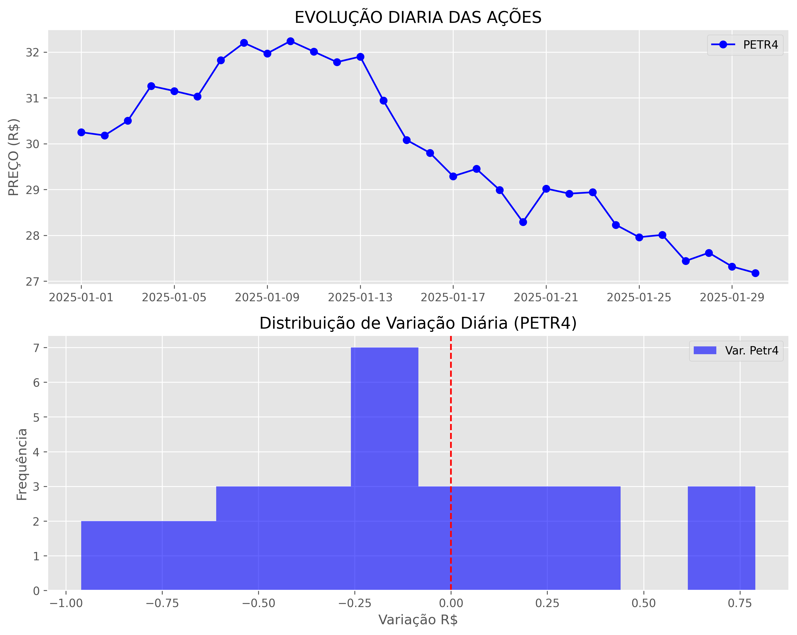

# 🐍 Data Science com Python: Pandas & Matplotlib (Hands-On)

Este repositório contém um guia prático e scripts de estudo focados em **análise, manipulação e visualização de dados** em Python utilizando **Pandas** e **Matplotlib** no ambiente VS Code.


## 📊 Visualizações e Resultados

### Análise de Recursos Humanos





### Análise Financeira


---

## 📌 Visão Geral do Projeto

O objetivo deste projeto é desenvolver habilidades práticas (*hands-on*) em Ciência de Dados através do tratamento de dados reais/simulados em planilhas Excel, solução de inconsistências (valores nulos, tipos de dados incorretos) e construção de dashboards visuais de mercado financeiro e RH.

---

## 🛠️ Tecnologias e Bibliotecas

* **Python 3.x**
* **Pandas**: Manipulação de dados, agrupamentos, tratamento de nulos e operações relacionais.
* **Matplotlib**: Criação de gráficos de linha, histogramas, customização de estilos e layouts com subplots.
* **OpenPyXL**: Suporte para leitura e escrita de arquivos Excel (`.xlsx`).

---

## 📁 Estrutura do Conjunto de Dados (`dados_treinamento_pandas.xlsx`)

A base de dados utilizada nos exercícios é dividida em 3 abas principais:

1. **`funcionarios`**: Tabela com dados cadastrais de colaboradores (idades com decimais, valores ausentes `NaN` em salários e status).
2. **`departamentos`**: Tabela relacional com orçamentos e gestores por setor (utilizada para junções `pd.merge()`).
3. **`acoes_bolsa`**: Série temporal diária com cotações de ações (`PETR4` e `ITUB4`) para análises temporais e gráficos.

---

## 🚀 Principais Tópicos & Comandos Praticados

### 1. Manipulação e Limpeza com Pandas
* **Leitura e Escrita Multi-Abas:** `pd.read_excel()` e `pd.ExcelWriter()`
* **Diagnóstico Inicial:** `df.info()`, `df.describe()`, `df['coluna'].dtype`
* **Tratamento de Nulos (`NaN`):** `df['idade'].fillna(df['idade'].mean())`
* **Conversão de Tipos:** `df['idade'].round().astype(int)`, `pd.to_datetime()`
* **Engenharia de Atributos:** Criação de colunas calculadas e variação temporal com `.diff()`
* **Agrupamentos Avançados:** `df.groupby().agg()` para resumos estatísticos por setor
* **Cruzamento de Dados:** `pd.merge(df_func, df_dept, on='id_dept', how='left')`

### 2. Visualização com Matplotlib
* **Estilização Visual:** `plt.style.use('ggplot')`
* **Layouts com Subplots:** `fig, (ax1, ax2) = plt.subplots(2, 1, figsize=(10, 8))`
* **Gráficos de Linha & Séries Temporais:** `ax.plot()` com marcadores e legendas
* **Histogramas & Distribuição de Frequência:** `ax.hist()` com linhas de referência `ax.axvline()`
* **Exportação de Imagens:** `plt.savefig('grafico_treinamento.png')`

---

## 💻 Como Executar o Projeto

1. **Clone este repositório no seu computador**
2. **Instale as dependências necessárias:**
   ```bash
   pip install pandas matplotlib openpyxl
   ```
3. **Execute o script principal no VS Code:**
   ```bash
   python solucao_treinamento.py
   ```

---

## 📊 Exemplo de Dashboard Gerado

O script gera um painel composto (subplots) analisando a tendência de preços e a distribuição de variação diária de ativos:
* **Gráfico Superior:** Evolução da cotação diária em R$.
* **Gráfico Inferior:** Histograma de variação diária com linha de referência zero.

---

## 📜 Licença

Este projeto é de uso livre para fins educacionais e de aprendizado.
